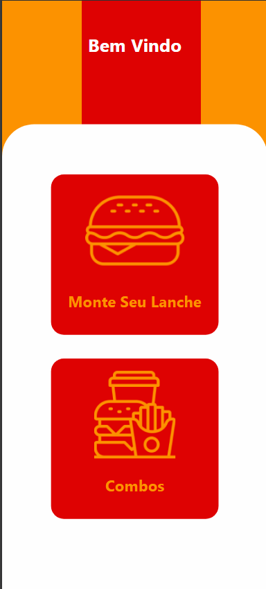

# 🍔 Sistema de Autoatendimento via Celular

Este projeto consiste em um sistema de autoatendimento acessado pelo celular, permitindo que o usuário monte seu próprio lanche ou escolha combos pré-definidos. O objetivo é oferecer uma experiência rápida, intuitiva e personalizada, facilitando o processo de pedido antes do pagamento no caixa.

---

## 🚀 Funcionalidades

- **Tela inicial** com opções de:
  - Combos prontos  
  - Montagem personalizada do lanche

- **Montagem do pedido** por meio de carrosséis/slides:
  - Seleção de ingredientes
  - Escolha de bebidas
  - Escolha de acompanhamentos

- **Resumo do pedido** gerado automaticamente conforme o usuário seleciona os itens.

- **Geração de QR Code** ao final do processo, que deve ser apresentado no caixa para finalizar o pagamento.

---

## 📱 Fluxo do Usuário

1. Acessa o sistema via celular.  
2. Escolhe entre combo ou montagem personalizada.  
3. Navega pelos carrosséis para selecionar ingredientes, bebidas e acompanhamentos.  
4. Visualiza o resumo final do pedido.  
5. Gera o QR Code.  
6. Apresenta o QR Code no caixa para pagar.

---

## 🖼 Prints do Projeto

>
>   
> .png) 
> .png)

---

## 🛠 Tecnologias Utilizadas

- HTML
- CSS
- JS
- Mongo DB

---

## 📌 Objetivo

Facilitar a experiência de compra, reduzir filas e permitir que o cliente personalize totalmente seu lanche antes de chegar ao caixa.

---
## Contribuidores <3
  Feito por [Lucas Bara](https://www.linkedin.com/in/lucas-barauna-386113241/) com :heart: e JS.
